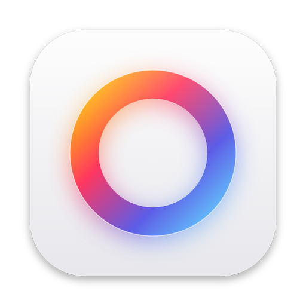

<p align="center">
  
</p>

# Halo

An app that pushes an XDR or HDR Mac display past its normal maximum brightness, up to 2x SDR white.

## How it works

macOS holds back extra brightness on these panels for HDR content. Halo puts a one-point EDR
window in the screen's bottom-left corner, under the rounded corner where you can't see it.
That keeps the display in EDR mode, and Halo then scales the display's gamma table above 1.0 so
everything on screen uses the headroom.

The boost tops out at 2x. The XDR panel holds about 1000 nits across the whole screen against
500 for SDR white, and past that it can only brighten small areas, so full-screen content would
clip.

If you dim the built-in display below 100%, Halo turns the boost off and turns it back on once
brightness is at 100% again.

## Requirements

- macOS 14 or later
- A display with EDR headroom, like the built-in XDR panel on a MacBook Pro

## Install

Download the latest zip from [Releases](https://github.com/kdbaustert/Halo/releases), unzip it and
move Halo.app to /Applications.

Releases are ad-hoc signed, not notarized, so macOS blocks the first launch. Right-click Halo.app
and choose Open, or run `xattr -cr /Applications/Halo.app`. Halo asks for no folder or privacy
access, so there's nothing to approve after that.

## Updates

Halo checks for a new version once a day and asks before installing it. You can check by hand or
change both settings in Settings > About. Every update is checked against Halo's signing key
before it installs.

A copy you build yourself never updates itself, so it can't be replaced by the published version.

## Using it

Click the sun in the menu bar to turn the boost on and set its strength with the slider.

In Settings (⌘, from the menu) you can:

- Launch Halo at login
- Turn the boost back on at launch if it was on when Halo quit
- Hide the menu bar icon. Open Halo again from Finder or Spotlight to get back to Settings.
- Set global shortcuts to toggle the boost or make it brighter or dimmer by 10%. They work from
  any app and need no Accessibility permission.

## Privacy

No telemetry, analytics, crash reporting or account. The only network request Halo makes on its
own is the update check, which fetches the release feed from GitHub Pages and sends nothing about
you or your Mac.

## Contributing

Issues and pull requests are welcome. To build and test:

```sh
./build.sh --install  # builds build/Halo.app, copies it to /Applications and launches it
swift test            # the test suite, which CI runs on every push and pull request
```

Building needs Xcode or the Xcode command line tools.

To cut a release, push a `v` tag such as `v0.2.0`. The release workflow builds, tests, publishes
the zip and updates the appcast. `./release.sh --adhoc` runs the same steps locally.

## License

Halo is licensed under the [GNU General Public License v3.0](LICENSE).

Built by [@kdbaustert](https://github.com/kdbaustert).
